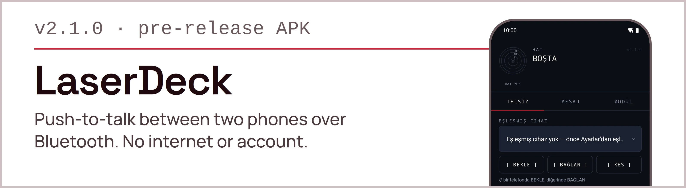
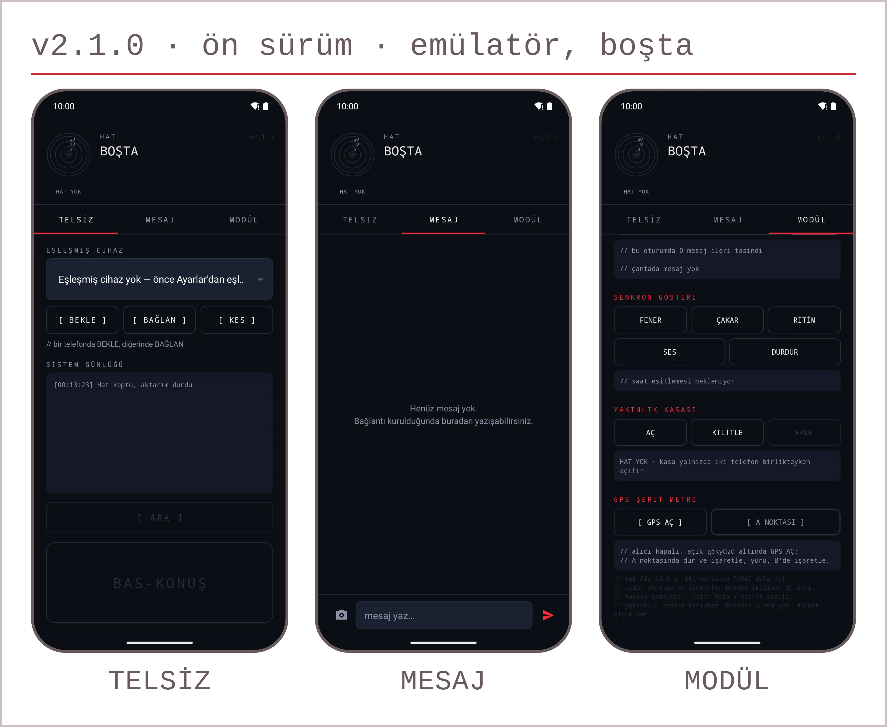
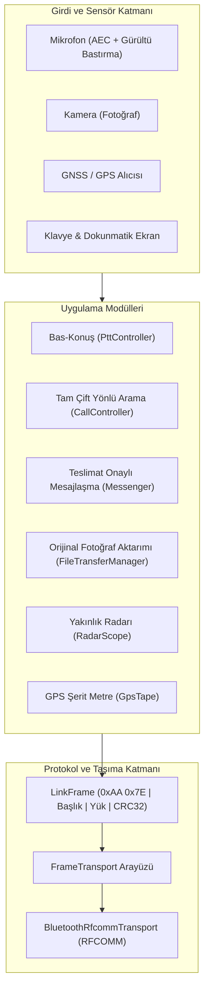

# LaserDeck

Push-to-talk, calls, messages and photos between two Android phones over Bluetooth, with no internet, server or account.

LaserDeck, birbirine yakın iki Android telefon arasında internetsiz, sunucusuz ve hesapsız bas-konuş, arama, mesajlaşma ve fotoğraf aktarımı sağlayan Kotlin uygulamasıdır.

**Durum:** v2.1.0 ön sürüm (pre-release). Birim testleri CI'da geçiyor; iki fiziksel telefonla kabul denemesi kayıtlı değil.

<picture>
  <source media="(prefers-color-scheme: dark)" srcset="docs/assets/laserdeck-hero-dark.webp">
  
</picture>

[](https://github.com/Voyagerroc/LaserDeck/actions/workflows/ci.yml)
[](LICENSE)
[](https://github.com/Voyagerroc/LaserDeck/releases/tag/v2.1.0)

## İndirme

[v2.1.0 sürüm sayfası](https://github.com/Voyagerroc/LaserDeck/releases/tag/v2.1.0) (ön sürüm): `laserdeck-ptt-2.1.0.apk` (yaklaşık 1,2 MB) ve `SHA256SUMS.txt` dosyası. APK'yı kurmadan önce SHA-256 özetini bu dosyayla karşılaştırın. Android 8.0 ve üstü gerekir. [Ürün sayfası](https://voyagerroctechnologies.com/urunler/laserdeck/) sitede.

Sürümdeki APK, var olan genel dağıtımdan değiştirilmeden alınmıştır; sürüm notları imza doğrulamasını ve neyin iddia edilmediğini açıklar. Bu APK kaynaktan yeniden derlenmedi ve kaynakla birebir eşleştiği kanıtlanmadı ([docs/RELEASE.md](docs/RELEASE.md)).

## Neler var, neler denendi

Aşağıdaki tablo kaynakta bulunan işlevleri ve CI'daki birim testlerinin neyi kapsadığını gösterir. Hiçbir satır iki fiziksel telefonla denenmiş sayılmaz: [docs/RELEASE.md](docs/RELEASE.md) bu sürüm için fiziksel cihaz kabul testi yapılmadığını kaydeder, [android/README.md](android/README.md) ise iki telefonlu denemeyi bir plan olarak anlatır.

| Özellik | Kaynakta | Birim testi |
|---|---|---|
| Bas-konuş (yarı çift yönlü) | Var | Yok. Yalnızca ortak çerçeve katmanı (`LinkFrame`) testli |
| Tam çift yönlü sesli arama (çaldırma, ahize/hoparlör, donanım yankı iptali ve gürültü bastırma) | Var | Yok |
| Mesajlaşma: teslim onayı, çevrimdışı kuyruk, cihaz içi geçmiş | Var | Var: kuyruk, onay, yeniden gönderim, tekrar eden kimlik, geçmiş (`MessengerTest`) |
| Fotoğraf aktarımı: orijinal baytlar, SHA-256 doğrulamalı | Var | Yok |
| Yakınlık radarı: iki telefon arası mesafe tahmini (Android 12 ve üstü) | Var | Yok |
| GPS şerit metre: tek telefonla A'dan B'ye mesafe, ± bandıyla | Var | Kısmen: jeodezi hesabı ve fix ortalaması (`GeodesyTest`); GPS alıcısı testli değil |
| Uygulama içi güncelleme denetimi | Var | Yok |

**Taşıyıcı:** Bluetooth Classic RFCOMM. İnternet, Wi-Fi, hücresel veri, sunucu ve hesap kullanılmaz. Uygulamanın yaptığı tek ağ çağrısı sürüm denetimidir ve hiçbir kullanıcı verisi taşımaz. Konum yalnızca GPS şerit metre modülü açıkken okunur ve cihazdan çıkmaz.

**Sınırlar.** Menzil görüş hattında yaklaşık 10–30 m beklenir; 4 MB'lık bir fotoğrafın yaklaşık iki dakika süreceği tahmin edilir. İkisi de radyonun fiziğine dayanan beklentidir, bu sürümde iki telefonla ölçülmedi. Donanım yankı iptali cihaza bağlıdır; yoksa arama ekranı bunu söyler. Radar mesafe ölçer, yön ölçmez: tek antenle yön üretilemez, hedef nokta değil halka olarak çizilir. GPS şerit metre tüketici alıcısının fiziğine bağlıdır: tek fix ±3–5 m; iki noktanın farkı daha iyidir ama hatasız değildir, her sonuç ± bandıyla yazılır.

## Ekran görüntüleri

<picture>
  <source media="(prefers-color-scheme: dark)" srcset="docs/assets/laserdeck-screens-dark.webp">
  
</picture>

Gerçek ekranlar: 2.1.0 hata ayıklama sürümü, Android emülatörü, boşta, çünkü ikinci telefon bağlı değildi. Hiçbir görüntü düzenlenmedi. Uygulamanın tek ve sabit bir koyu teması vardır; arayüz Türkçedir. GPS şerit metre kapalıdır, görüntüde ölçüm yoktur. `android/play/` altındaki mağaza görselleri üretilmiş tasarımlardır, cihaz görüntüsü değildir.

## Derleme

Gerekenler: JDK 17, Android SDK Platform 36, Git ve ilk bağımlılık indirmeleri için ağ erişimi. Gradle sarmalayıcı, Android Gradle Plugin ve Kotlin sürümleri [`android/gradle/wrapper/gradle-wrapper.properties`](android/gradle/wrapper/gradle-wrapper.properties) ile [`android/build.gradle.kts`](android/build.gradle.kts) içinde tanımlıdır; ayrıca sistem Gradle kurulumu gerekmez. SDK yolunu yerel `android/local.properties` içindeki `sdk.dir` ile veya `ANDROID_HOME` ile tanımlayın; bu dosya depoya girmez.

Windows PowerShell:

```powershell
cd android
.\gradlew.bat :app:testDebugUnitTest :app:assembleDebug --no-daemon
```

Linux/macOS:

```sh
cd android
chmod +x gradlew
./gradlew :app:testDebugUnitTest :app:assembleDebug --no-daemon
```

Bu komutlar imza anahtarı veya fiziksel cihaz istemez. Debug APK `android/app/build/outputs/apk/debug/` altında oluşur. Release imzalama ve dağıtım kanıtı için [sürüm kontrol listesini](docs/RELEASE.md), kaynak haritası ve iki telefonlu deneme planı için [Android kılavuzunu](android/README.md) okuyun.

## Mimari

Tüm modüller taşıyıcıdan bağımsız `LinkFrame` çerçeve katmanı üzerinde çalışır; taşıyıcı `FrameTransport` arayüzünün arkasındadır.



## Dağıtım

Sürüm sitesi Cloudflare Workers üzerindedir: `android/play/` altında mağaza paketi, gizlilik politikası ve `surum.json` sürüm bildirimi bulunur. Güvenlik bildirimi için [SECURITY.md](SECURITY.md), katkı için [CONTRIBUTING.md](CONTRIBUTING.md), iletişim için [sitenin iletişim sayfası](https://voyagerroctechnologies.com/yasal/iletisim/).

## Lisans

MIT, bkz. [LICENSE](LICENSE).

Erol Taşcı, Voyagerroc Technologies · [voyagerroctechnologies.com](https://voyagerroctechnologies.com/)
