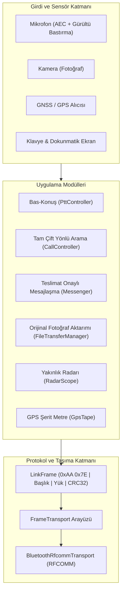

# LaserDeck

Push-to-talk, voice calls, messages and photos between two nearby Android phones over Bluetooth, with no internet, server or account. For people who need to talk where there is no signal: field work, hiking, events, building sites.

**Türkçe özet:** LaserDeck, birbirine yakın iki Android telefon arasında internet, sunucu veya hesap gerektirmeden bas-konuş, sesli arama, mesajlaşma ve fotoğraf aktarımı sağlayan bir uygulamadır. Bağlantı yalnızca Bluetooth üzerinden kurulur; kapsama alanı olmayan yerlerde iletişim için tasarlanmıştır. Uygulama şu an v2.1.0 ön sürüm (pre-release) aşamasındadır.

**Status:** v2.1.0 pre-release (MVP, testing before launch). Unit tests run in CI; no two-phone physical acceptance test is recorded yet.

[](https://github.com/Voyagerroc/LaserDeck/actions/workflows/ci.yml)

<picture>
  <source media="(prefers-color-scheme: dark)" srcset="docs/assets/laserdeck-screens-dark.webp">
  
</picture>

*Real emulator screenshots (2.1.0 debug build, no second phone connected); only frames and labels were added. The app UI is in Turkish with a single fixed dark theme. Store graphics under `android/play/` are designed artwork, not device captures.*

## What it does

- **Push-to-talk** (half duplex), like a walkie-talkie.
- **Full-duplex voice calls** with echo cancellation and noise suppression where the device supports it.
- **Messaging** with delivery receipts, offline queue and history.
- **Photo transfer** of the original bytes, verified with SHA-256.
- **Proximity radar** (Android 12+): shows distance as a ring, not direction.
- **GPS tape measure**: distance between two points, always shown with a ± error band.

Everything runs over Bluetooth Classic RFCOMM. No internet, Wi-Fi, mobile data, server or account is used. The only network call is an update check that carries no user data. Location is read only while the GPS tape measure is open and never leaves the device.

## Who it is for

- Pairs or small teams who need to talk where there is no mobile coverage (outdoors, rural sites, basements, events).
- Anyone who prefers private device-to-device communication without accounts or cloud services.
- Android developers interested in a Bluetooth RFCOMM framing/transport design in Kotlin.

## Download

[v2.1.0 release page](https://github.com/Voyagerroc/LaserDeck/releases/tag/v2.1.0) (pre-release): `laserdeck-ptt-2.1.0.apk` (about 1.2 MB) and `SHA256SUMS.txt`. Compare the SHA-256 before installing. Requires Android 8.0 (API 26) or newer. Product page: [voyagerroctechnologies.com/urunler/laserdeck](https://voyagerroctechnologies.com/urunler/laserdeck/).

The release APK is the existing public build, attached unchanged; it was not rebuilt from this source and is not proven byte-identical to it. See [docs/RELEASE.md](docs/RELEASE.md).

## Feature and test coverage

Every feature below exists in the source. The second column shows what CI unit tests cover. None is counted as accepted on two physical phones yet ([docs/RELEASE.md](docs/RELEASE.md); the two-phone plan is in [android/README.md](android/README.md)).

| Feature | Unit tests |
|---|---|
| Push-to-talk | None; only `LinkFrame` is tested |
| Full-duplex call (AEC, noise suppression) | None |
| Messaging (receipts, offline queue, history) | Yes (`MessengerTest`) |
| Photo transfer (original bytes, SHA-256) | None |
| Proximity radar (Android 12+) | None |
| GPS tape measure (± band) | Partly: math tested (`GeodesyTest`), receiver not |
| In-app update check | None |

**Limits.** Expected range is roughly 10–30 m line of sight, based on radio physics, not measured with two phones in this release. Hardware echo cancellation depends on the device; the call screen says so when it is missing. The radar measures distance only (one antenna cannot give direction). A single consumer GPS fix is about ±3–5 m; the difference of two points is better but not error-free.

## For developers

**Tech stack:** Kotlin 2.1.0, Android Gradle Plugin 8.10.1, Gradle wrapper, compileSdk/targetSdk 36, minSdk 26. CI on GitHub Actions (`.github/workflows/ci.yml`), plus `.gitlab-ci.yml`.

**Repo layout**

```
android/            Android app (Gradle project)
  app/src/main/     Kotlin sources (com.voyagerroc...), resources, manifest
  app/src/test/     JVM unit tests
  play/             Store listing assets, privacy policy, surum.json version manifest
docs/RELEASE.md     Release checklist and provenance notes
docs/assets/        README screenshots
```

**Build and test.** Requirements: JDK 17, Android SDK Platform 36, Git, and network access for the first dependency download. Set the SDK path via `sdk.dir` in a local `android/local.properties` (not committed) or `ANDROID_HOME`.

Windows PowerShell:

```powershell
cd android
.\gradlew.bat :app:testDebugUnitTest :app:assembleDebug --no-daemon
```

Linux/macOS:

```sh
cd android
chmod +x gradlew
./gradlew :app:testDebugUnitTest :app:assembleDebug --no-daemon
```

No signing key or physical device is needed. The debug APK is written to `android/app/build/outputs/apk/debug/`. For release signing see [docs/RELEASE.md](docs/RELEASE.md); for the source map and two-phone test plan see [android/README.md](android/README.md).

### Architecture

All modules sit on the transport-independent `LinkFrame` framing layer; the carrier is behind the `FrameTransport` interface (currently `BluetoothRfcommTransport`). Diagram labels are in Turkish, matching the app.



### Distribution

The release site runs on Cloudflare Workers; `android/play/` contains the store package, privacy policy and the `surum.json` version manifest used by the update check.

## Contributing, security, license

- Contributing: [CONTRIBUTING.md](CONTRIBUTING.md)
- Security reports: [SECURITY.md](SECURITY.md)
- Contact: [voyagerroctechnologies.com/yasal/iletisim](https://voyagerroctechnologies.com/yasal/iletisim/)
- License: MIT, see [LICENSE](LICENSE)

Made by [Voyagerroc Technologies](https://voyagerroctechnologies.com/).
