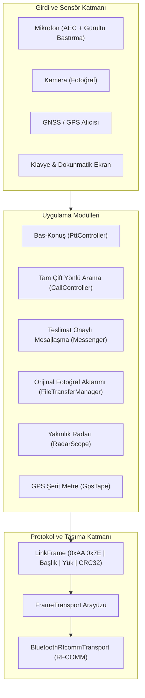

<div align="center">

# 📟 LaserDeck PTT — Offline Telefon-Telefon İletişim

**İnternetsiz • Sunucusuz • Hesapsız • Nokta-Noktaya Bluetooth İletişim Uygulaması**

[](https://github.com/Voyagerroc/LaserDeck/actions/workflows/ci.yml)
[](https://developer.android.com/)
[](https://kotlinlang.org/)
[](https://en.wikipedia.org/wiki/Bluetooth)
[](https://gitlab.com/Voyagerroc/LaserDeck)
[](https://opensource.org/licenses/MIT)

</div>

---

<!-- voyagerroc-brand:start -->
## Voyagerroc Technologies

[LaserDeck PTT product overview / ürün sayfası](https://voyagerroctechnologies.com/urunler/laserdeck/) · [Voyagerroc Technologies — applications, SaaS & Si workflows](https://voyagerroctechnologies.com/)

Product scope, available access and limitations are documented on the product page. / Ürün kapsamı, erişim durumu ve sınırlar ürün sayfasında açıklanır.
<!-- voyagerroc-brand:end -->

## 📖 Genel Bakış

LaserDeck PTT, iki Android telefon arasında **internet, sunucu ve hesap olmadan**
doğrudan Bluetooth üzerinden çalışan yerel bir iletişim uygulamasıdır: bas-konuş,
tam çift yönlü sesli arama, mesajlaşma, fotoğraf aktarımı ve yakınlık radarı.

**[⬇ APK indir](https://laserdeck-ptt.voyagerroc.workers.dev)** · Android 8.0+ · ~1 MB · hesap yok, sunucu yok

| Özellik | Durum |
|---|---|
| Bas-konuş (half-duplex) sesli iletişim | ✅ |
| Tam çift yönlü sesli arama (çaldırma, cevaplama, ahize/hoparlör, donanım AEC + gürültü bastırma) | ✅ |
| Teslimat onaylı mesajlaşma, çevrimdışı kuyruk, cihaz içi geçmiş | ✅ |
| Fotoğraf aktarımı — orijinal baytlar, SHA-256 doğrulamalı, yeniden sıkıştırma yok | ✅ |
| Yakınlık radarı — iki telefon arası mesafe tahmini | ✅ (Android 12+) |
| GPS şerit metre — tek telefonla A→B mesafesi, ± bandıyla | ✅ |
| Uygulama içi güncelleme denetimi | ✅ |

**Taşıyıcı:** Bluetooth Classic RFCOMM. İnternet, Wi-Fi, hücresel veri, sunucu ve
hesap kullanılmaz. Uygulamanın yaptığı tek ağ çağrısı sürüm denetimidir ve hiçbir
kullanıcı verisi taşımaz. Konum yalnızca GPS şerit metre modülü açıkken okunur ve
cihazdan çıkmaz.

**Dürüst sınırlar.** Menzil görüş hattında 10–30 m. 4 MB'lık bir fotoğraf yaklaşık
iki dakika sürer — bu yazılımın değil radyonun tavanıdır. Donanım yankı iptali cihaza
bağlıdır ve yoksa arama ekranı bunu açıkça söyler. Radar mesafe ölçer, yön ölçmez:
tek antenle yön üretilemez, hedef nokta değil halka olarak çizilir. GPS şerit metre
tüketici alıcısının fiziğine bağlıdır: tek fix ±3–5 m; iki noktanın farkı daha iyidir
ama "hatasız" değildir — her sonuç ± bandıyla yazılır.

---

## 🏗️ Mimari

Tüm modüller taşıyıcıdan bağımsız `LinkFrame` çerçeve katmanı üzerinde çalışır;
taşıyıcı `FrameTransport` arayüzünün arkasındadır.



Ayrıntılı katman tablosu, kurulum ve yol haritası: [`android/README.md`](android/README.md)

## 🔨 Derleme

```bash
cd android
gradlew :app:testDebugUnitTest   # protokol birim testleri (cihaz gerekmez)
gradlew :app:assembleRelease     # imzalı APK (keystore.properties gerekir)
```

## 🚀 Dağıtım

Sürüm sitesi Cloudflare Workers üzerinde: `android/play/` altında mağaza paketi,
gizlilik politikası ve `surum.json` sürüm bildirimi bulunur.

---

## 🔗 Depo Bağlantıları

- **GitHub:** [Voyagerroc/LaserDeck](https://github.com/Voyagerroc/LaserDeck)
- **GitLab:** [Voyagerroc/LaserDeck](https://gitlab.com/Voyagerroc/LaserDeck)

---

## 📜 Lisans

**MIT License** © 2026 Erol Tasci — araştırma, eğitim ve açık mühendislik için serbesttir.
